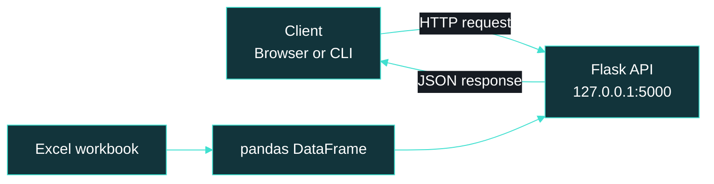
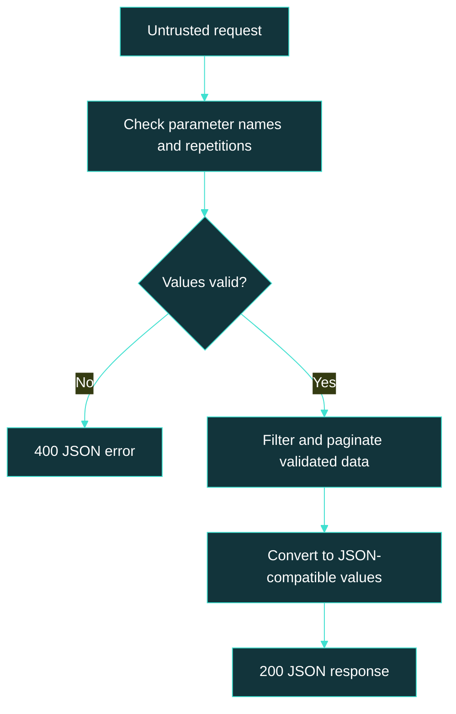
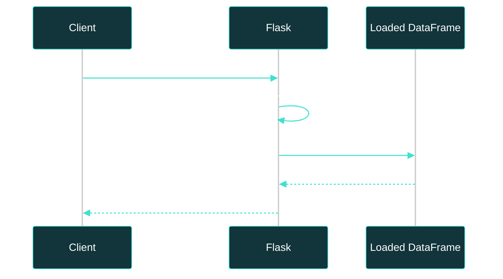

# Building APIs with Python & Flask | Cybersecurity & Social Engineering

## [CLASS 6](#overview): [Cybersecurity and Social Engineering](#cybersecurity-and-social-engineering) / [Building APIs](#building-apis)

A practical learning guide to networking, HTTP, REST concepts, Flask, query strings, JSON, and Excel integration with pandas—with security awareness built into the development process.

Learn how a browser communicates with a Python application, how spreadsheet data becomes an API response, and why technical safeguards and human judgment must work together.

> Educational scope: this repository is a study and portfolio project, not an official institutional publication or a production-ready API.

<br><br>

#

<br><br>

<p align="center">
  
  
  
  
  
</p>


<br><br>

#

<br><br>

<a id="repository-information"></a>
## [Repository Information](#repository-information)

| Field | Content |
|---|---|
| Repository name | `5-cybersecurity-social-engineering-building-apis` |
| Class | Class 6 — Building APIs |
| Main language | Python |
| Web framework | Flask |
| Data tools | pandas and openpyxl |
| Data source | A reproducible Excel workbook containing fictional products |
| Default execution | Local computer, loopback interface |
| Learning context | API development, networking, data integration, and defensive security |


<br><br>

<a id="table-of-contents"></a>
## [Table of Contents](#table-of-contents)

1. [Overview](#overview)
2. [Academic Context and Source Boundaries](#academic-context)
3. [Learning Objectives](#learning-objectives)
4. [Prerequisites and Project Structure](#prerequisites)
5. [Networking Foundations](#networking-foundations)
6. [HTTP, REST, and JSON](#http-rest-json)
7. [Query Strings, Encoding, and Defaults](#query-strings)
8. [Architecture and Request Lifecycle](#architecture)
9. [Building APIs: Complete Implementation](#building-apis)
10. [Running the Project Locally](#running-locally)
11. [Request and Response Examples](#request-examples)
12. [Automated Tests](#automated-tests)
13. [pandas, Excel, and Data Science](#data-science)
14. [Cybersecurity and Social Engineering](#cybersecurity-and-social-engineering)
15. [API Security Checklist](#api-security)
16. [Why Run This Lab Locally Instead of Colab?](#colab)
17. [Networking Diagnostics and Troubleshooting](#troubleshooting)
18. [Common Misconceptions and Corrections](#misconceptions)
19. [Limitations and Production Considerations](#production)
20. [Glossary](#glossary)
21. [Bibliographic References](#references)

<br><br>

<a id="overview"></a>
## [Overview](#overview)

An API (Application Programming Interface) defines how software components interact. In this project, a client sends an HTTP (Hypertext Transfer Protocol) request to a Flask application. The application selects or summarizes data and returns JSON (JavaScript Object Notation).

Imagine a restaurant:

- The client is the customer.
- The API contract is the menu.
- An endpoint is a specific service offered by the kitchen.
- Request parameters describe what the customer wants.
- The server processes the request.
- The response delivers the result.

The analogy has limits: a real API also defines data types, methods, status codes, validation rules, and security requirements.

The complete local example follows this flow:

```text
Excel workbook
      ↓
pandas DataFrame
      ↓
Validation and filtering
      ↓
Flask endpoint
      ↓
JSON response
      ↓
Browser, command-line client, or another application
```

This lab is intentionally read-only. It teaches API behavior without introducing the misleading idea that an Excel workbook is a reliable concurrent database.

<br><br>

<a id="academic-context"></a>
## [Academic Context and Source Boundaries](#academic-context)

The supplied programmatic-content PDF belongs to a Distributed Systems course associated with the Data Science and Artificial Intelligence program at PUC-SP.

Its sixth lesson covers communication technologies in distributed systems, including RPC (Remote Procedure Call), RMI (Remote Method Invocation), gRPC, SOA (Service-Oriented Architecture), message-oriented middleware, REST, sockets, and WebSockets, alongside seminar preparation.

The project title used here identifies this repository's learning theme. It should not be interpreted as the exact official title of lesson six in that PDF.

### Existing material versus the complementary lab

The repository includes a class-material directory named:

```text
class_6-Buildig_APIs_with_Flask/
```

The spelling above preserves the existing directory name.

The implementation presented below is a separate, complementary teaching example. It does not claim to reproduce or validate the original notebooks, slides, datasets, or instructor code.

Security discussions and defensive examples expand the learning context rather than establish what was formally assessed in the course.

<br><br>

<a id="learning-objectives"></a>
## [Learning Objectives](#learning-objectives)

After completing this guide, you should be able to:

- Explain clients, servers, hosts, ports, and loopback addresses.
- Distinguish network connectivity from application availability.
- Understand HTTP requests, JSON responses, and REST-oriented resource design.
- Build Flask routes and access path and query parameters.
- Apply defaults without silently accepting invalid input.
- Read an Excel workbook into a pandas DataFrame.
- Return filtered, paginated data through an API.
- Write automated tests without starting a network server.
- Recognize common API risks and social engineering warning signs.
- Explain why a development server is not a production deployment.

<br><br>

<a id="prerequisites"></a>
## [Prerequisites and Project Structure](#prerequisites)

You need:

- Python 3.11 or newer for the example.
- A terminal.
- A text editor, such as Visual Studio Code.
- A web browser.
- Internet access for the initial dependency installation.

Basic Python knowledge helps, but the guide explains the main concepts before using them.

### Proposed complementary structure

Create a separate directory named `class_6_api_lab` in the repository root:

```text
5-cybersecurity-social-engineering-building-apis/
├── class_6-Buildig_APIs_with_Flask/   # Existing class materials
├── class_6_api_lab/                 # Complementary lab described here
│   ├── app.py
│   ├── generate_data.py
│   ├── requirements.txt
│   ├── .gitignore
│   ├── data/
│   │   └── products.xlsx            # Generated locally
│   └── tests/
│       └── test_app.py
└── README.md
```

The code blocks below are file contents. Copy each block into its named file before running the commands.

<br><br>

<a id="networking-foundations"></a>
## [Networking Foundations](#networking-foundations)

### Client, server, host, and port

A client requests a service. A server provides it.

These are roles, not necessarily different machines. Your browser and Flask server can run on the same laptop.

A host is a network-connected system. An IP (Internet Protocol) address identifies a network interface or endpoint in an IP network. A port identifies a transport-layer communication endpoint used by an application.

For this address:

```text
http://127.0.0.1:5000/api/health
```

| Part | Meaning |
|---|---|
| `http` | Application protocol scheme |
| `127.0.0.1` | IPv4 loopback address |
| `5000` | Port used by this application |
| `/api/health` | Requested resource path |

Think of the IP address as a building address and the port as a particular service desk inside it.

### localhost and loopback

`localhost` is a hostname conventionally resolved to loopback addresses, commonly `127.0.0.1` for IPv4 and `::1` for IPv6.

Loopback sends traffic back to the same machine rather than to another device on the network.

| Address | Purpose |
|---|---|
| `127.0.0.1` | Reach the same machine using IPv4 loopback |
| `localhost` | Hostname that normally resolves to loopback |
| `::1` | IPv6 loopback |
| `0.0.0.0` | In a server binding, listen on all local IPv4 interfaces |

`0.0.0.0` is not the normal destination address to give another user. A remote client uses the server's actual reachable address.

If Flask listens only on `127.0.0.1`, another device cannot reach that listener through the server's private network address.

Also remember: on a phone, `localhost` means the phone—not your laptop.

### Public and private IP addresses

A private IP address is intended for private-network use. Common IPv4 private ranges are:

| Range | Prefix |
|---|---|
| `10.0.0.0`–`10.255.255.255` | `10.0.0.0/8` |
| `172.16.0.0`–`172.31.255.255` | `172.16.0.0/12` |
| `192.168.0.0`–`192.168.255.255` | `192.168.0.0/16` |

A public IP address belongs to globally routable address space, although filtering and network policy can still prevent access.

NAT (Network Address Translation) commonly allows devices using private IPv4 addresses to share an external address.

Having a public address does not automatically publish a Flask application. The service must be running, listening on an appropriate interface, and reachable through the relevant firewall and routing configuration.

### Static and dynamic IP addresses

These describe address assignment, not whether an address is public or private.

| Property | Meaning |
|---|---|
| Public | Address belongs to globally routable space |
| Private | Address belongs to private-network space |
| Static | Address is configured or assigned to remain stable |
| Dynamic | Address is leased or otherwise assigned with potential to change |

DHCP (Dynamic Host Configuration Protocol) commonly assigns network configuration automatically.

Possible combinations include:

- Private and dynamic: a laptop receiving an address from a home router.
- Private and stable: an internal server with a reservation or static configuration.
- Public and dynamic: a residential connection whose external address can change.
- Public and static: a hosted service with a stable external address.

Residential addresses are not always dynamic, institutional addresses are not always static, and static addressing does not universally require a paid subscription.

<br><br>

<a id="http-rest-json"></a>
## [HTTP, REST, and JSON](#http-rest-json)

### What happens during an HTTP request?

The client specifies:

- A method.
- A resource path.
- Headers.
- An optional request body.

The server returns:

- A status code.
- Headers.
- An optional response body.

For this local lab, HTTP operates over TCP (Transmission Control Protocol). HTTPS (Hypertext Transfer Protocol Secure) adds transport protection through TLS (Transport Layer Security).

### REST-oriented design

REST (Representational State Transfer) is an architectural style, not a Python package or a synonym for JSON.

This project uses resource-oriented paths and read-only methods. It is a small REST-oriented HTTP API, not a demonstration of every REST constraint.

Using Flask, HTTP, and JSON does not automatically establish full REST compliance.

| Method | Typical purpose | Implemented here? |
|---|---|---|
| GET | Retrieve a representation | Yes |
| POST | Submit data or create a resource | No |
| PUT | Replace a resource representation | No |
| PATCH | Partially update a resource | No |
| DELETE | Remove a resource | No |

Flask also supports automatic `HEAD` and `OPTIONS` behavior for the GET routes.

### JSON versus a Python dictionary

A Python dictionary is an in-memory object:

```python
product = {"id": 1, "available": True, "description": None}
```

JSON is a text format:

```json
{
  "id": 1,
  "available": true,
  "description": null
}
```

Serialization converts supported Python values into a representation such as JSON. Deserialization converts JSON text into programming-language values.

JSON uses double-quoted property names, lowercase `true` and `false`, and `null`.

### Status codes

| Code | Meaning | Relationship to this lab |
|---|---|---|
| `200` | Request succeeded | Successful GET responses |
| `201` | Resource created | Not used; no creation endpoint |
| `400` | Invalid request | Invalid query parameters |
| `401` | Valid authentication is missing | Not implemented |
| `403` | Request is forbidden | Not implemented |
| `404` | Resource not found | Unknown route or product |
| `405` | Method not allowed | POST sent to a GET-only route |
| `415` | Unsupported media type | Relevant to body-processing endpoints; not used here |
| `500` | Unexpected server failure | Generic error response |

The absence of `401` and `403` responses means this API has no authentication or authorization system. It does not mean every caller is trusted in a production context.

<br><br>

<a id="query-strings"></a>
## [Query Strings, Encoding, and Defaults](#query-strings)

Consider:

```text
http://127.0.0.1:5000/api/products?category=books&limit=5
```

The query string is:

```text
category=books&limit=5
```

| Symbol | Role |
|---|---|
| `?` | Starts the query component |
| `=` | Associates a parameter name with its value |
| `&` | Separates parameter pairs |

### Path parameters versus query parameters

```text
/api/products/1
```

The path identifies product `1`.

```text
/api/products?category=books
```

The query filters the product collection.

### Parameter contract

| Parameter | Default | Accepted values |
|---|---|---|
| `category` | No category filter | One nonempty string, at most 50 characters |
| `limit` | `10` | Integer from `1` to `100` |
| `offset` | `0` | Integer from `0` to `1,000,000` |

This lab rejects:

- Unknown query parameters.
- Repeated query parameters.
- Empty numeric values.
- Invalid integers.
- Out-of-range values.
- Empty category values.

An unknown but syntactically valid category returns an empty collection, not an error.

### Default does not mean “accept anything”

The implementation applies a default only when a parameter is absent.

```text
/api/products
```

Uses `limit=10`.

```text
/api/products?limit=
```

Returns `400`.

```text
/api/products?limit=hello
```

Also returns `400`.

A shorthand such as `request.args.get("limit", 10, type=int)` can fall back to the default when conversion fails. This project uses explicit validation so invalid values do not silently become defaults.

### Repeated parameters

A URL can contain:

```text
/api/products?category=books&category=electronics
```

Different applications interpret repeated parameters differently. This lab deliberately rejects them to keep the contract unambiguous.

### Encoding

URL encoding represents characters in a form suitable for URLs.

For example:

```text
café → caf%C3%A9
```

The accented character is represented using percent-encoded UTF-8 bytes.

Spaces may appear as `%20`, or as `+` in form-style query encoding. A literal plus sign must be encoded appropriately, commonly as `%2B`.

Use a library instead of manually concatenating user input:

```python
from urllib.parse import urlencode

parameters = {"category": "café", "limit": 5}
url = "http://127.0.0.1:5000/api/products?" + urlencode(parameters)

print(url)
```

Expected output:

```text
http://127.0.0.1:5000/api/products?category=caf%C3%A9&limit=5
```

| Concept | Purpose |
|---|---|
| Encoding | Represent data using a defined format |
| Encryption | Protect confidentiality using cryptographic keys |
| Hashing | Produce a digest, commonly for integrity-related applications |

Encoding is not encryption. Never put passwords or API credentials in query strings: URLs can be recorded in histories and logs.

<br><br>

<a id="architecture"></a>
## [Architecture and Request Lifecycle](#architecture)

### Client-server architecture



### Request lifecycle and trust boundary



### Sequence



Rendering details can vary between Mermaid versions and GitHub themes.

<br><br>

<a id="building-apis"></a>
## [Building APIs: Complete Implementation](#building-apis)

The application uses an application factory: a function that creates and configures a Flask instance.

This makes testing easier because tests can supply their own temporary workbook instead of relying on personal files.

### File 1 — `requirements.txt`

These version ranges express the intended dependency families. They are not a fully locked or independently verified environment.

```text
Flask>=3.1,<4
pandas>=2.2,<4
openpyxl>=3.1,<4
pytest>=8,<10
```

Flask handles HTTP routing. pandas processes tables. openpyxl reads and writes `.xlsx` files. pytest runs the automated tests.

### File 2 — `.gitignore`

Keep local environments, generated data, caches, and secrets out of version control.

```gitignore
.venv/
__pycache__/
*.py[cod]
.pytest_cache/
.coverage
htmlcov/
.env
.env.*
!.env.example
data/*.xlsx
```

No `.env` file is required by this implementation.

### File 3 — `generate_data.py`

The script creates a small workbook with fictional records. Prices use integer cents to avoid introducing binary floating-point arithmetic into the monetary examples.

It refuses to overwrite an existing workbook unless `--overwrite` is explicitly supplied.

```python
import argparse
from pathlib import Path

import pandas as pd

BASE_DIR = Path(__file__).resolve().parent
DATA_FILE = BASE_DIR / "data" / "products.xlsx"


def generate_data(overwrite=False):
    if DATA_FILE.exists() and not overwrite:
        raise SystemExit(
            "Workbook already exists. Use --overwrite to replace it."
        )

    DATA_FILE.parent.mkdir(parents=True, exist_ok=True)

    records = [
        {
            "id": 1,
            "name": "Python Basics",
            "category": "books",
            "price_cents": 4990,
        },
        {
            "id": 2,
            "name": "Network Fundamentals",
            "category": "books",
            "price_cents": 6990,
        },
        {
            "id": 3,
            "name": "USB Keyboard",
            "category": "electronics",
            "price_cents": 8990,
        },
        {
            "id": 4,
            "name": "Coffee Mug",
            "category": "café",
            "price_cents": 2990,
        },
    ]

    pd.DataFrame(records).to_excel(
        DATA_FILE,
        index=False,
        engine="openpyxl",
    )

    print(f"Created {DATA_FILE}")


if __name__ == "__main__":
    parser = argparse.ArgumentParser()
    parser.add_argument("--overwrite", action="store_true")
    arguments = parser.parse_args()
    generate_data(overwrite=arguments.overwrite)
```

### File 4 — `app.py`

The application:

1. Loads the workbook at startup.
2. Validates the expected columns and values.
3. Keeps a read-only in-memory snapshot.
4. Validates incoming query parameters.
5. Returns JSON responses.
6. Preserves HTTP error headers when formatting errors.

Invalid workbook data stops startup instead of being silently exposed.

```python
import json
import math
import re
from pathlib import Path

import pandas as pd
from flask import Flask, abort, jsonify, request
from werkzeug.exceptions import HTTPException

BASE_DIR = Path(__file__).resolve().parent
DEFAULT_DATA_FILE = BASE_DIR / "data" / "products.xlsx"
REQUIRED_COLUMNS = ["id", "name", "category", "price_cents"]


def load_products(data_file):
    frame = pd.read_excel(data_file, engine="openpyxl")

    missing_columns = set(REQUIRED_COLUMNS) - set(frame.columns)
    if missing_columns:
        raise ValueError(
            f"Missing workbook columns: {sorted(missing_columns)}"
        )

    frame = frame.loc[:, REQUIRED_COLUMNS].copy()

    if frame.isna().any().any():
        raise ValueError("Required workbook values cannot be missing.")

    for column, minimum in (("id", 1), ("price_cents", 0)):
        numbers = pd.to_numeric(frame[column], errors="raise")

        valid = numbers.map(
            lambda value: (
                not isinstance(value, bool)
                and math.isfinite(float(value))
                and float(value).is_integer()
                and minimum <= value <= 2**53 - 1
            )
        )

        if not valid.all():
            raise ValueError(f"Invalid integer values in {column}.")

        frame[column] = numbers.astype("int64")

    if frame["id"].duplicated().any():
        raise ValueError("Product IDs must be unique.")

    for column in ("name", "category"):
        if not frame[column].map(lambda value: isinstance(value, str)).all():
            raise ValueError(f"{column} must contain text.")

        frame[column] = frame[column].str.strip()

        if frame[column].eq("").any():
            raise ValueError(f"{column} cannot contain empty text.")

    return frame.sort_values("id").reset_index(drop=True)


def create_app(data_file=None):
    app = Flask(__name__)
    app.json.ensure_ascii = False

    source = Path(data_file) if data_file is not None else DEFAULT_DATA_FILE
    products = load_products(source)

    def validate_query(allowed):
        unexpected = set(request.args) - set(allowed)
        if unexpected:
            abort(400, description="Unknown query parameter.")

        for name in request.args:
            if len(request.args.getlist(name)) != 1:
                abort(400, description=f"{name} must appear only once.")

    def integer_parameter(name, default, minimum, maximum):
        raw = request.args.get(name)

        if raw is None:
            return default

        if len(raw) > 16 or re.fullmatch(r"[0-9]+", raw) is None:
            abort(400, description=f"{name} must be an integer.")

        value = int(raw)

        if not minimum <= value <= maximum:
            abort(
                400,
                description=(
                    f"{name} must be between {minimum} and {maximum}."
                ),
            )

        return value

    def as_records(frame):
        return json.loads(frame.to_json(orient="records", force_ascii=False))

    @app.get("/api/health")
    def health():
        validate_query(set())
        return jsonify(status="ok", service="class-6-api")

    @app.get("/api/products")
    def list_products():
        validate_query({"category", "limit", "offset"})

        limit = integer_parameter("limit", 10, 1, 100)
        offset = integer_parameter("offset", 0, 0, 1_000_000)

        filtered = products
        category = request.args.get("category")

        if category is not None:
            category = category.strip()

            if not category or len(category) > 50:
                abort(
                    400,
                    description="category must contain 1 to 50 characters.",
                )

            filtered = products.loc[
                products["category"].str.casefold() == category.casefold()
            ]

        page = filtered.iloc[offset:offset + limit]

        return jsonify(
            data=as_records(page),
            meta={
                "total": int(len(filtered)),
                "count": int(len(page)),
                "limit": limit,
                "offset": offset,
            },
        )

    @app.get("/api/products/<int:product_id>")
    def get_product(product_id):
        validate_query(set())
        selected = products.loc[products["id"] == product_id]

        if selected.empty:
            abort(404, description="Product not found.")

        return jsonify(data=as_records(selected))

    @app.get("/api/summary")
    def summary():
        validate_query(set())

        groups = (
            products.groupby("category", as_index=False)
            .agg(
                product_count=("id", "size"),
                total_price_cents=("price_cents", "sum"),
            )
        )

        return jsonify(
            currency="BRL",
            product_count=int(len(products)),
            total_price_cents=int(products["price_cents"].sum()),
            categories=as_records(groups),
        )

    @app.errorhandler(HTTPException)
    def handle_http_error(error):
        response = error.get_response()
        response.data = app.json.dumps(
            {
                "error": {
                    "status": error.code,
                    "message": error.description,
                }
            }
        )
        response.content_type = "application/json"
        return response

    @app.errorhandler(Exception)
    def handle_unexpected_error(error):
        app.logger.exception("Unexpected request failure.")
        return jsonify(
            error={
                "status": 500,
                "message": "An unexpected server error occurred.",
            }
        ), 500

    return app


if __name__ == "__main__":
    create_app().run(
        host="127.0.0.1",
        port=5000,
        debug=False,
    )
```

### Understanding the implementation

| Element | Purpose |
|---|---|
| `Path(__file__).resolve().parent` | Locate files relative to the application |
| `pd.read_excel(...)` | Load workbook data into a DataFrame |
| `create_app(...)` | Create an application with a selectable dataset |
| `@app.get(...)` | Associate a URL path with a GET handler |
| `request.args` | Access query parameters |
| `abort(...)` | Stop request processing with an HTTP error |
| `jsonify(...)` | Create a JSON HTTP response |
| `iloc[...]` | Select a page of rows by position |
| `casefold()` | Apply case-insensitive matching |
| `debug=False` | Keep the interactive debugger disabled |

The general error handler does not return exception details to the client. Diagnostic traces can still appear in server logs, so logs must be protected in real deployments.

No user-controlled filename is accepted. The API reads a fixed local workbook rather than allowing callers to choose arbitrary files.

<br><br>

<a id="running-locally"></a>
## [Running the Project Locally](#running-locally)

Create the files first, then run these commands from the repository root.

### 1. Enter the complementary lab

```bash
cd class_6_api_lab
```

### 2. Create a virtual environment

Windows:

```powershell
py -3 -m venv .venv
```

Linux/macOS:

```bash
python3 -m venv .venv
```

A virtual environment isolates this project's Python dependencies from other projects.

### 3. Activate it

Windows PowerShell:

```powershell
.\.venv\Scripts\Activate.ps1
```

Linux/macOS:

```bash
source .venv/bin/activate
```

If PowerShell blocks activation, you can use the environment's interpreter directly without changing execution policy:

```powershell
.\.venv\Scripts\python.exe -m pip install -r requirements.txt
.\.venv\Scripts\python.exe generate_data.py
.\.venv\Scripts\python.exe app.py
```

### 4. Install dependencies

With the environment activated:

```bash
python -m pip install -r requirements.txt
```

### 5. Generate the workbook

```bash
python generate_data.py
```

To deliberately replace the generated workbook:

```bash
python generate_data.py --overwrite
```

Do not use this command against a workbook containing changes you need to preserve.

### 6. Start the API

```bash
python app.py
```

Open:

```text
http://127.0.0.1:5000/api/health
```

Stop the server with:

```text
Ctrl+C
```

### Alternative port

If port `5000` is unavailable:

```bash
python -m flask --app app:create_app run --host 127.0.0.1 --port 5001
```

Then use `5001` in all request URLs.

The workbook must already exist before Flask creates the application.

<br><br>

<a id="request-examples"></a>
## [Request and Response Examples](#request-examples)

The following responses are expected examples for the generated dataset. They are not a claim of independently verified execution.

### Health check

```text
http://127.0.0.1:5000/api/health
```

```json
{
  "status": "ok",
  "service": "class-6-api"
}
```

This indicates that the application handled the request. It is not a comprehensive infrastructure or dependency health assessment.

### List products with defaults

```text
http://127.0.0.1:5000/api/products
```

The default page has `limit=10` and `offset=0`.

### Filter and paginate

```text
http://127.0.0.1:5000/api/products?category=books&limit=1&offset=0
```

Expected response:

```json
{
  "data": [
    {
      "id": 1,
      "name": "Python Basics",
      "category": "books",
      "price_cents": 4990
    }
  ],
  "meta": {
    "total": 2,
    "count": 1,
    "limit": 1,
    "offset": 0
  }
}
```

`total` counts all matching records before pagination. `count` counts only records returned on this page.

### Retrieve one product

```text
http://127.0.0.1:5000/api/products/1
```

```json
{
  "data": {
    "id": 1,
    "name": "Python Basics",
    "category": "books",
    "price_cents": 4990
  }
}
```

### Summary

```text
http://127.0.0.1:5000/api/summary
```

The generated dataset contains four products with a combined listed price of `23960` cents, or BRL 239.60.

This sum represents one listed price per product. It is not sales revenue or inventory valuation because the dataset has no sales quantities or stock counts.

### Invalid parameter

```text
http://127.0.0.1:5000/api/products?limit=hello
```

Expected status: `400`.

```json
{
  "error": {
    "status": 400,
    "message": "limit must be an integer."
  }
}
```

### Command-line requests

Linux/macOS:

```bash
curl -i "http://127.0.0.1:5000/api/health"
curl -i "http://127.0.0.1:5000/api/products?category=books&limit=1"
```

Windows PowerShell:

```powershell
curl.exe -i "http://127.0.0.1:5000/api/health"
curl.exe -i "http://127.0.0.1:5000/api/products?category=books&limit=1"
```

Using `curl.exe` avoids ambiguity with PowerShell aliases on systems where `curl` maps to another command.

Keep URLs containing `&` quoted so the shell does not interpret the separator itself.

<br><br>

<a id="automated-tests"></a>
## [Automated Tests](#automated-tests)

Tests use a temporary workbook and Flask's test client. They do not require a running HTTP server or the generated demonstration workbook.

### File 5 — `tests/test_app.py`

```python
import pandas as pd
import pytest

from app import create_app


@pytest.fixture
def client(tmp_path):
    workbook = tmp_path / "products.xlsx"

    pd.DataFrame(
        [
            {
                "id": 1,
                "name": "Test Book",
                "category": "books",
                "price_cents": 1000,
            },
            {
                "id": 2,
                "name": "Test Keyboard",
                "category": "electronics",
                "price_cents": 2500,
            },
        ]
    ).to_excel(workbook, index=False, engine="openpyxl")

    application = create_app(workbook)
    application.config["TESTING"] = True

    with application.test_client() as test_client:
        yield test_client


def test_health(client):
    response = client.get("/api/health")
    assert response.status_code == 200
    assert response.get_json()["status"] == "ok"


def test_default_listing(client):
    response = client.get("/api/products")
    payload = response.get_json()

    assert response.status_code == 200
    assert payload["meta"] == {
        "total": 2,
        "count": 2,
        "limit": 10,
        "offset": 0,
    }


def test_filter(client):
    response = client.get("/api/products?category=BOOKS")
    payload = response.get_json()

    assert response.status_code == 200
    assert payload["meta"]["total"] == 1
    assert payload["data"]["id"] == 1


def test_pagination(client):
    response = client.get("/api/products?limit=1&offset=1")
    payload = response.get_json()

    assert payload["meta"]["count"] == 1
    assert payload["data"]["id"] == 2


@pytest.mark.parametrize(
    "query",
    [
        "limit=abc",
        "limit=",
        "limit=0",
        "limit=101",
        "offset=-1",
        "offset=1000001",
        "category=",
        "unknown=value",
        "limit=1&limit=2",
    ],
)
def test_invalid_queries(client, query):
    response = client.get(f"/api/products?{query}")
    assert response.status_code == 400
    assert response.is_json


def test_unknown_category(client):
    response = client.get("/api/products?category=missing")
    assert response.status_code == 200
    assert response.get_json()["data"] == []


def test_product(client):
    response = client.get("/api/products/1")
    assert response.status_code == 200
    assert response.get_json()["data"]["name"] == "Test Book"


def test_missing_product(client):
    response = client.get("/api/products/999")
    assert response.status_code == 404
    assert response.is_json


def test_missing_route(client):
    response = client.get("/missing")
    assert response.status_code == 404


def test_method_not_allowed(client):
    response = client.post("/api/products", json={"name": "Not created"})
    assert response.status_code == 405
    assert "GET" in response.headers["Allow"]


def test_summary(client):
    response = client.get("/api/summary")
    payload = response.get_json()

    assert response.status_code == 200
    assert payload["product_count"] == 2
    assert payload["total_price_cents"] == 3500
```

Run from `class_6_api_lab`:

```bash
python -m pytest -q
```

Passing these tests would confirm the behaviors asserted here, not prove the application secure or production-ready.

No coverage percentage or successful test execution is claimed in this document.

<br><br>

<a id="data-science"></a>
## [pandas, Excel, and Data Science](#data-science)

### What is pandas?

pandas is a Python library for working with structured data.

A DataFrame is a two-dimensional labeled table with columns and rows. It resembles a spreadsheet, but supports programmatic filtering, grouping, transformation, and analysis.

```python
frame = pd.read_excel("products.xlsx", engine="openpyxl")
```

In this project, `openpyxl` is the explicitly selected Excel engine.

### Why load data once?

The application loads the workbook during startup.

Advantages:

- Requests avoid repeatedly parsing the workbook.
- Validation happens before serving requests.
- Each process uses a stable snapshot.

Limitations:

- Workbook changes are not reflected until restart.
- Each process keeps its own copy in memory.
- Large workbooks can consume excessive memory.
- Startup fails if the source is missing or invalid.

Reading on every request would provide a different freshness tradeoff but add repeated disk access and workbook parsing. It would not solve concurrent-write or transactional consistency problems.

### Missing values and JSON compatibility

Real datasets can contain missing values, dates, non-finite numbers, and library-specific scalar types.

Do not assume that every DataFrame value can be passed directly to a JSON serializer.

This lab takes a strict approach:

- Required missing values are rejected.
- IDs and prices must be finite integers.
- Names and categories must be nonempty text.
- pandas serializes the validated records before Flask returns them.

For a different dataset, define an explicit policy for missing values and timestamps rather than silently changing their meaning.

### Pagination formula

For a one-based page number $p$ and page size $L$:

$$
\text{offset} = (p - 1)L
$$

For page 3 with 10 records per page:

$$
\text{offset} = (3 - 1)\times10 = 20
$$

This API accepts `offset` directly, not a `page` parameter.

### Summary formula

The combined listed price is:

$$
T = \sum_{i=1}^{n} c_i
$$

where:

- $T$ is the total in cents.
- $n$ is the number of products.
- $c_i$ is the listed price of product $i$ in cents.

Integer cents simplify these examples. Production financial systems still need explicit rules for currency, rounding, taxes, and precision.

### When to replace Excel

Consider a database when the application needs:

- Concurrent writes.
- Transactions.
- Persistent updates.
- Indexed queries.
- Access control at the data layer.
- Larger datasets.
- Auditing and recovery.

An API is an access layer. It does not transform a spreadsheet into a transactional database.

<br><br>

<a id="cybersecurity-and-social-engineering"></a>
## [Cybersecurity and Social Engineering](#cybersecurity-and-social-engineering)

Cybersecurity protects systems and information. Social engineering manipulates people into making unsafe decisions.

An API can have well-validated parameters and still be compromised if someone shares credentials, installs a malicious dependency, or follows a fraudulent support instruction.

### Confidentiality, integrity, and availability

| Goal | Meaning | Example |
|---|---|---|
| Confidentiality | Prevent unauthorized disclosure | Do not expose private spreadsheet records |
| Integrity | Prevent unauthorized or unnoticed alteration | Protect the source workbook and dependency files |
| Availability | Keep a service usable | Bound requests and plan capacity |

The sample dataset is fictional. Do not replace it with personal, financial, medical, or institutional data without an appropriate security and privacy review.

### Common social engineering patterns

| Pattern | Warning sign | Defensive response |
|---|---|---|
| Phishing | A message requests credentials through an unfamiliar link | Open the official service independently |
| Pretexting | A supposed technician invents a reason to obtain access | Verify identity through a separate trusted channel |
| Impersonation | An account claims to be a professor or maintainer | Confirm the request before sharing information |
| Urgency pressure | “Disable protection immediately or lose access” | Pause and verify |
| Malicious command request | Someone asks you to paste an unexplained shell command | Inspect its behavior and source first |
| Secret harvesting | A request asks for `.env`, tokens, or screenshots of credentials | Do not share secrets; report the request |

### Threats connected to this project

| Threat | Example | Potential impact | Mitigation |
|---|---|---|---|
| Accidental network exposure | Binding the lab to all interfaces | Other reachable devices can query it | Keep the default loopback binding |
| Debugger exposure | Publishing the interactive debugger | Remote code execution risk | Keep debugging disabled outside controlled local development |
| Sensitive data exposure | Replacing fictional data with private records | Privacy breach | Minimize data and introduce real access controls |
| Oversized requests | Attempting large pages | Increased processing and response size | Validate limits; add broader resource controls for deployment |
| Secret leakage | Placing a token in a URL | Exposure in logs or history | Keep credentials out of URLs |
| Malicious dependency | Following an unverified installation instruction | Local compromise | Verify package names, sources, and changes |
| Source tampering | Editing the workbook without authorization | Incorrect API results | Protect file access and maintain change history |

The validation implemented here addresses only part of these risks.

<br><br>

<a id="api-security"></a>
## [API Security Checklist](#api-security)

### Implemented in the complementary lab

- Loopback binding by default.
- Debugger disabled by default.
- Read-only endpoints.
- Fixed local dataset path.
- Required-column validation.
- Input validation and explicit bounds.
- Rejection of repeated and unknown query parameters.
- Generic responses for unexpected server failures.
- Fictional demonstration data.

### Not implemented

- Authentication.
- Authorization.
- HTTPS termination.
- Rate limiting.
- Request-size limits for a broader deployment.
- Centralized audit logging.
- Persistent database storage.
- Dependency vulnerability scanning.
- A production application server.
- Deployment-level monitoring and recovery.

### Authentication versus authorization

Authentication asks: “Who are you?”

Authorization asks: “What are you allowed to do?”

A valid identity does not imply permission to access every resource.

### Least privilege

Give each user, process, and service only the access required for its task.

For this API, the process does not need administrative privileges or permission to modify unrelated files.

### CORS is not authentication

CORS (Cross-Origin Resource Sharing) affects which browser-based cross-origin requests can expose responses to frontend JavaScript.

It does not authenticate users or prevent non-browser clients from making requests.

Do not treat permissive CORS settings as a fix for connection refusal or as an API access-control strategy.

### Logging and secrets

Logs can contain paths, query strings, error details, or other sensitive information.

Protect logs, avoid recording credentials, and define retention rules.

A `.gitignore` entry does not remove a secret that has already been committed. Exposed credentials need revocation or rotation.

<br><br>

<a id="colab"></a>
## [Why Run This Lab Locally Instead of Colab?](#colab)

> Recommendation: use a local Python environment for this Flask networking lab. Do not use Google Colab as the primary API hosting environment.

Flask can run inside Colab, but that does not make Colab the simplest or most appropriate environment for this exercise.

| Issue | Explanation |
|---|---|
| Remote runtime | Python executes on a remote machine, not directly on your laptop |
| Different localhost | Runtime `127.0.0.1` refers to that runtime |
| Temporary lifecycle | Sessions can disconnect or terminate |
| External access | Reaching a runtime service requires additional mechanisms |
| Tunnel exposure | A tunnel can make a local runtime service externally reachable |
| Learning overhead | Forwarding and remote-runtime behavior obscure basic networking concepts |

A notebook interface displaying output does not automatically expose a Flask port to your local browser.

Public tunnels are intentionally excluded from the default instructions.

Colab can still help with data exploration, isolated functions, and some testing. The recommendation concerns using it as the main server environment for this lab—not a claim that Flask is impossible or prohibited there.

<br><br>

<a id="troubleshooting"></a>
## [Networking Diagnostics and Troubleshooting](#troubleshooting)

### What does `ping 127.0.0.1` test?

The correct address is:

```text
127.0.0.1
```

Not:

```text
127..0.0.1
127.0.0 1
```

`ping` generally uses ICMP (Internet Control Message Protocol) echo requests.

A successful loopback ping indicates that the local system answered that loopback test.

It does not prove that:

- The machine has internet access.
- DNS works.
- Flask is running.
- Port `5000` is listening.
- The API returns valid HTTP.
- Another device can reach the computer.

A failure also does not justify the vague conclusion that “the machine is not enabled.” Command syntax, local configuration, filtering, and operating-system behavior need investigation.

### Windows diagnostics

```powershell
ping -n 4 127.0.0.1
ipconfig
Test-NetConnection -ComputerName 127.0.0.1 -Port 5000
curl.exe -i "http://127.0.0.1:5000/api/health"
```

### Linux diagnostics

```bash
ping -c 4 127.0.0.1
ip addr
curl -i "http://127.0.0.1:5000/api/health"
```

### macOS diagnostics

```bash
ping -c 4 127.0.0.1
ifconfig
curl -i "http://127.0.0.1:5000/api/health"
```

### Interpret each layer separately

| Observation | Reasonable interpretation |
|---|---|
| Loopback ping works | The loopback echo test succeeded |
| TCP port test works | A TCP connection to that port succeeded |
| HTTP returns `404` | A server answered, but the requested resource was not found |
| HTTP returns `400` | The request reached the application but failed validation |
| Connection refused | No accepting listener was available, or a component actively rejected the connection |
| Hostname fails but an IP works | Name resolution may be involved; investigate DNS or local hostname configuration |

DNS (Domain Name System) translates names into addresses. A DNS failure and an unavailable Flask process are different problems.

### Common application errors

| Problem | Check |
|---|---|
| `ModuleNotFoundError` | Confirm the correct environment and installed dependencies |
| `FileNotFoundError` | Run `python generate_data.py` |
| Workbook validation failure | Check columns, missing values, IDs, and prices |
| Port already in use | Stop the conflicting process or choose another port |
| `/` returns `404` | Use `/api/health`; no root route is defined |
| Another device cannot connect | The lab intentionally listens only on loopback |
| Excel edits are not visible | Restart the application to reload the workbook |
| Invalid parameter returns `400` | Review the documented query contract |

Do not disable the firewall as a generic troubleshooting step.

### Installing dependencies without internet access

An offline machine cannot download packages directly from the package index.

On a trusted connected machine with a compatible Python version, operating system, and architecture, prepare wheels:

```bash
python -m pip download --only-binary=:all: -r requirements.txt -d wheelhouse
```

Transfer the wheel directory and requirements file through an approved method.

On the offline machine:

```bash
python -m pip install --no-index --find-links=wheelhouse -r requirements.txt
```

All required compatible distributions must be present. If the connected and offline systems differ, dependency preparation requires additional platform-specific care.

This is a package-distribution workflow, not a substitute for diagnosing an operating-system networking fault.

<br><br>

<a id="misconceptions"></a>
## [Common Misconceptions and Corrections](#misconceptions)

| Misconception | Correction |
|---|---|
| “Ping proves Flask is working.” | Ping tests ICMP behavior, not the HTTP endpoint |
| “Loopback ping proves internet access.” | Loopback traffic stays on the local machine |
| “IRC is required for internet access.” | IRC (Internet Relay Chat) is a chat protocol, not a general connectivity prerequisite |
| “ITC must be a networking component.” | The abbreviation in the notes is ambiguous; no meaning should be invented |
| “localhost is always my laptop.” | It refers to the machine or runtime where it is evaluated |
| “0.0.0.0 is the address to send to another user.” | In this context it is a wildcard listening address |
| “Public means reachable.” | Routing, filtering, NAT, and listener configuration still matter |
| “Static means public.” | Address scope and assignment stability are independent |
| “Encoding protects secrets.” | Encoding is not encryption |
| “JSON is a Python dictionary.” | JSON is a text representation |
| “Every invalid query automatically returns 400.” | That behavior depends on explicit validation and framework handling |
| “Flask cannot run in Colab.” | It can, but remote-runtime access adds complications |
| “Localhost makes an application completely safe.” | Local processes, source files, dependencies, and users still matter |
| “An API key makes a service production-ready.” | Deployment security requires multiple controls |

<br><br>

<a id="production"></a>
## [Limitations and Production Considerations](#production)

This repository demonstrates concepts. It is not a deployment blueprint.

Before exposing a real service, assess:

1. Data sensitivity and legal obligations.
2. Authentication and resource-level authorization.
3. HTTPS and trusted certificate management.
4. A production WSGI (Web Server Gateway Interface) server.
5. Reverse-proxy and network configuration.
6. Database transactions and concurrency.
7. Request limits and abuse prevention.
8. Safe logging and monitoring.
9. Dependency updates and vulnerability review.
10. Backups, recovery, and operational ownership.

Flask's built-in development server and interactive debugger are not intended for production.

This API has no write endpoints. Adding POST, PUT, PATCH, or DELETE requires additional design for validation, persistence, authorization, conflicts, and failure recovery.

No verified benchmark, test coverage percentage, security certification, or production-readiness claim is made.

<br><br>

<a id="glossary"></a>
## [Glossary](#glossary)

| Term | Meaning |
|---|---|
| API | Application Programming Interface |
| CLI | Command-Line Interface |
| CORS | Cross-Origin Resource Sharing |
| DataFrame | Labeled two-dimensional table used by pandas |
| DHCP | Dynamic Host Configuration Protocol |
| DNS | Domain Name System |
| Endpoint | An addressable API operation, commonly identified by method and path |
| HTTP | Hypertext Transfer Protocol |
| HTTPS | Hypertext Transfer Protocol Secure |
| ICMP | Internet Control Message Protocol |
| IP | Internet Protocol |
| JSON | JavaScript Object Notation |
| Loopback | Communication directed back to the same machine |
| NAT | Network Address Translation |
| REST | Representational State Transfer |
| Serialization | Conversion of values into a transferable representation |
| TCP | Transmission Control Protocol |
| TLS | Transport Layer Security |
| URL | Uniform Resource Locator |
| WSGI | Web Server Gateway Interface |

<br><br>

<a id="references"></a>
## [Bibliographic References](#references)

### Course and repository context

1. Pontifícia Universidade Católica de São Paulo. *Programmatic Content: Consultoria Especializada de Apoio ao Projeto Integrado — Sistemas Distribuídos*. First semester, 2026. Supplied course-plan PDF.  
   https://github.com/Quantum-Software-Development/1-Distributed-Systems-Operating-Systems-Hub/blob/main/Programmatic%20Content.pdf

2. Quantum Software Development. *Cybersecurity and Social Engineering — Building APIs*. Repository and class-material context.  
   https://github.com/Quantum-Software-Development/5-cybersecurity-social-engineering-building-apis

### Implementation documentation

3. Pallets Projects. *Flask Quickstart*. Routing, query parameters, JSON responses, and development-server behavior.  
   https://flask.palletsprojects.com/en/stable/quickstart/

4. pandas development team. *pandas.read_excel*. Workbook loading and Excel-engine configuration.  
   https://pandas.pydata.org/docs/reference/api/pandas.read_excel.html

### Recommended technical and security reading

5. Python Software Foundation. *urllib.parse — Parse URLs into components*.  
   https://docs.python.org/3/library/urllib.parse.html

6. Python Software Foundation. *venv — Creation of virtual environments*.  
   https://docs.python.org/3/library/venv.html

7. openpyxl project. *openpyxl Documentation*.  
   https://openpyxl.readthedocs.io/en/stable/

8. pytest development team. *pytest Documentation*.  
   https://docs.pytest.org/en/stable/

9. MDN Web Docs. *HTTP request methods*.  
   https://developer.mozilla.org/en-US/docs/Web/HTTP/Reference/Methods

10. MDN Web Docs. *HTTP response status codes*.  
    https://developer.mozilla.org/en-US/docs/Web/HTTP/Reference/Status

11. OWASP Foundation. *OWASP API Security Project*.  
    https://owasp.org/www-project-api-security/

12. OWASP Cheat Sheet Series. *REST Security Cheat Sheet*.  
    https://cheatsheetseries.owasp.org/cheatsheets/REST_Security_Cheat_Sheet.html

13. Google. *Google Colab Frequently Asked Questions*.  
    https://research.google.com/colaboratory/faq.html

14. Internet Engineering Task Force. *RFC 1918 — Address Allocation for Private Internets*.  
    https://www.rfc-editor.org/rfc/rfc1918

15. GitHub Docs. *Creating diagrams*.  
    https://docs.github.com/en/get-started/writing-on-github/working-with-advanced-formatting/creating-diagrams

16. GitHub Docs. *Writing mathematical expressions*.  
    https://docs.github.com/en/get-started/writing-on-github/working-with-advanced-formatting/writing-mathematical-expressions
